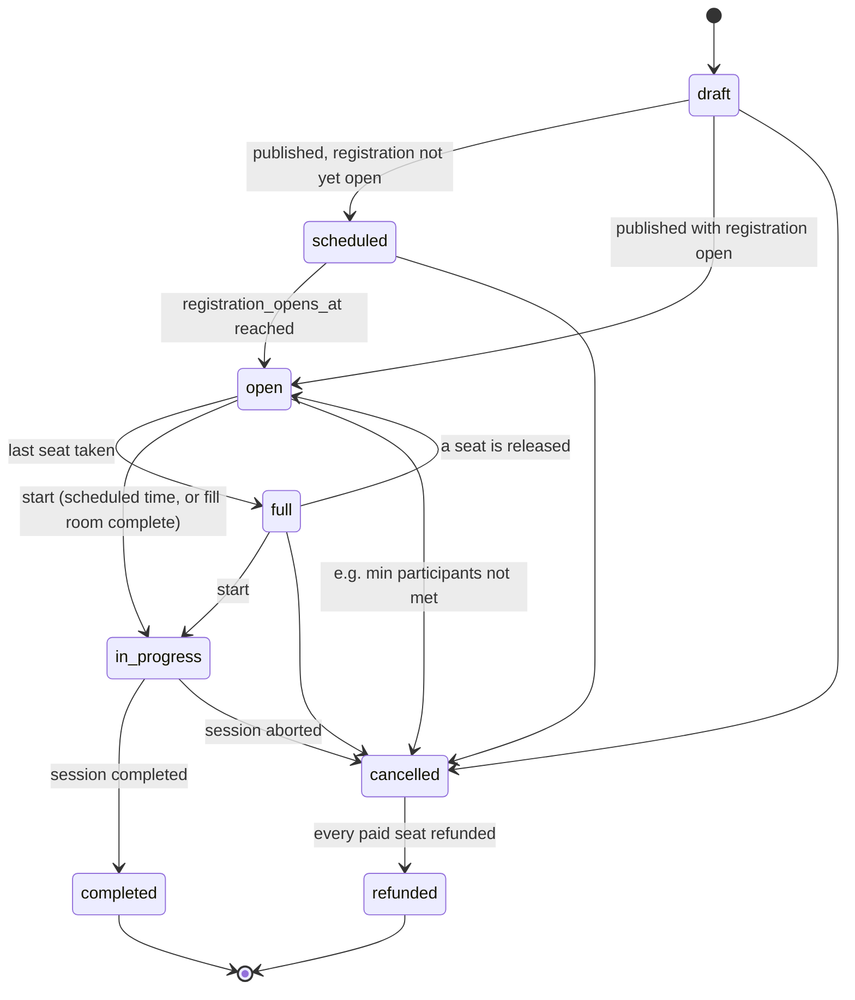

# Architecture

Real-time multiplayer MCQ competition platform. Laravel 12, Blade, MariaDB/MySQL,
Laravel Reverb + Echo, database queues, scheduler.

Status: Phase 01 (database foundation) is implemented. Service, engine and UI sections describe
the target design for later phases. Each phase updates the relevant section when it ships.

---

## 1. Guiding rules

- The server is authoritative for time, prices, scores, balances, rankings and identity.
  The client never sends any of these. It sends only intent: "join room X", "answer option Y".
- Money is an integer in minor units (paisa). Column suffix `_minor`. No floats anywhere in money paths.
- Every state-changing financial or competition operation runs in a DB transaction, takes
  row locks where it reads-then-writes, and is idempotent (unique keys, not "check then insert").
- Real-money features (paid entries, deposits, withdrawals, cash prizes) are behind
  `config('competition.paid_entries.enabled')` and the payment gateway driver. Both are off by default.
- Correct answers never leave the server before the question closes.

## 2. Directory and module organization

Standard Laravel layout. The code is grouped by domain *inside* the conventional folders,
so it doesn't need a custom module system.

```
app/
  Contracts/Payments/PaymentGateway.php      gateway interface (Phase 03)
  Enums/                                     backed enums with transition rules: RoomStatus, SessionStatus, ...
  Events/Competition/                        broadcast events (QuestionOpened, ...)
  Exceptions/                                domain exceptions (InsufficientBalance, InvalidTransition)
  Http/
    Controllers/                             public pages, account area
    Controllers/Admin/                       admin dashboard (role-gated)
    Middleware/
    Requests/  Requests/Admin/               Form Requests, one per write action
  Jobs/Competition/                          OpenQuestion, CloseQuestion, FinalizeCompetition
  Models/
  Notifications/
  Policies/
  Services/
    Audit/AuditLogger.php
    Competition/                             CompetitionStateMachine, EntryService, AnswerService
    Payments/                                gateway drivers: DisabledGateway, FakeGateway
    Questions/                               paper builder, snapshotting
    Scoring/                                 ScoringService, RankingService, PrizeDistributor
    Wallet/                                  LedgerService (the only writer of ledger rows)
  Support/Money.php                          integer money value object + formatting
config/competition.php                       platform switches (exists)
resources/views/
  layouts/  components/  public/  account/  competitions/  admin/
resources/js/  app.js, echo.js, competition/*.js (plain JS modules, no framework)
routes/  web.php, channels.php (Phase 05), console.php (scheduler)
tests/   Feature/<Domain>/  Unit/<Domain>/
docs/
```

## 3. Coding conventions

| Area | Rule |
|---|---|
| Style | Laravel Pint, default `laravel` preset. `vendor/bin/pint --test` must pass. |
| Tables | plural snake_case (`room_participants`). Pivot tables are alphabetical singulars. |
| Columns | money `*_minor` (BIGINT); timestamps `*_at` (UTC); booleans `is_*` / `has_*`; FKs `<model>_id` with constraints. |
| Enums | PHP backed string enums in `app/Enums`, stored as native `ENUM` with literal values in migrations, cast on the model. `SchemaEnumAlignmentTest` keeps them in sync. |
| Controllers | thin. Validate via Form Request, authorize via Policy, delegate to a Service. |
| Services | `<Noun>Service` or a specific role name (`LedgerService`, `PrizeDistributor`). They own the transactions. |
| Events | past tense (`QuestionOpened`). Jobs are imperative (`CloseQuestion`). |
| Routes | named, dot-separated: `admin.questions.index`, `competitions.join`. |
| Mass assignment | explicit `$fillable`; engine and financial models have none (services use `forceFill`). Never fill `role`, `balance`, `score`, `status` from request data. |
| Time | `now()` on the server only. Store UTC, render in `competition.display_timezone`. |
| Tests | every policy, every state transition and every money path get a test. Concurrency tests run on MariaDB. |

## 4. Data model

Implemented in Phase 01. **[DATABASE.md](DATABASE.md)** is the authoritative reference for tables,
relationships, indexes, constraints and retention rules.

A *room* (`rooms`) holds the configuration and registration lifecycle. Its single
*competition session* (`competition_sessions`) holds the live engine state and the immutable question
snapshot (`session_questions`, `session_question_options`). Seats are `room_participants`.
Answers are `answer_submissions`. Status changes are recorded in the append-only `audit_logs`
table (action `room.status_changed`, etc.), so there is no separate transitions table.

## 5. Competition lifecycle

Two state machines, defined as transition tables on the enums
(`App\Enums\RoomStatus`, `SessionStatus`, `ParticipantStatus`).

Room (registration side):



Session (engine side): `pending → countdown → in_progress → scoring → completed`, and any
non-terminal state can go to `aborted`.

- A future `CompetitionStateMachine` service will apply these tables. Each transition takes
  `SELECT ... FOR UPDATE` on the row, checks `canTransitionTo()`, writes an audit log entry and
  dispatches side effects after commit.
- **Joining** is allowed only in `open` (`RoomStatus::acceptsParticipants()`). The fee debit, seat insert and
  capacity check happen in one transaction. A cancellation refunds every paid entry
  through the ledger, idempotently keyed per entry.
- **Timing:** on `in_progress` the server writes absolute `opens_at` / `closes_at` for each
  question. Clients get `server_now` with each event to correct for clock skew. The timer
  display is cosmetic.
- **Progression:** delayed queue jobs (`OpenQuestion`, `CloseQuestion`) drive the game. A
  scheduler command (`competitions:tick`, every second) re-checks due transitions, so a lost
  job or a restarted worker can't stall a room. Both paths are idempotent.
- **Answers** are accepted only when the server's `received_at` falls inside
  [`opens_at`, `closes_at` + configured grace]. The unique constraint rejects resubmits.
- **Answer reveal:** no correct answer is sent during the live competition (not even in
  `QuestionClosed`); answers are revealed with the results. See docs/ENGINE.md.
- **Scoring and tie-breakers (proposed, confirm in Phase 06):** score desc, then sum of
  response time for correct answers asc. Remaining exact ties share the rank and split the
  combined tier prizes equally, with the leftover paisa going to the earliest correct finisher
  (a documented, deterministic rule).

## 6. Real-time infrastructure

| Piece | Choice | Why |
|---|---|---|
| WebSocket server | **Laravel Reverb** (first-party, PHP) | no external service or Node server, Pusher protocol |
| Client | `laravel-echo` + `pusher-js` | official Reverb client |
| Event dispatch | `ShouldBroadcast` via queue | keeps request latency low |
| Queue | `database` locally, Redis recommended in production | already configured in skeleton |

Channels (no private data on shared channels):

| Channel | Type | Auth | Payload |
|---|---|---|---|
| `competitions` | public | none | lobby: status changes, seat counts |
| `competition.{id}` | private | user has an entry in competition `id` | question text and options (no answer key), timings, `server_now`, leaderboard (display name + score only) |
| `App.Models.User.{id}` | private | `id` = auth user | personal notifications, own answer result |

Presence channels are not used for rooms, because they broadcast every member's user
data to every other member.

Local development processes (Windows/XAMPP):

```
php artisan serve          # or Apache vhost
php artisan reverb:start   # WebSocket server, default port 8080
php artisan queue:work     # broadcasts + competition jobs
php artisan schedule:work  # competitions:tick
npm run dev                # Vite
```

PHP on Windows has no `pcntl`, so graceful signal handling is unavailable for workers and
Reverb. That's acceptable for development. Production should run on Linux, with Supervisor
managing `reverb:start` and `queue:work`, plus a cron or systemd timer for the scheduler.

## 7. Payments abstraction (Phase 03)

`App\Contracts\Payments\PaymentGateway` will expose `initiateDeposit`, `verifyCallback`,
`initiatePayout` and `fetchStatus`. Drivers:

- `disabled` (default): every call throws `PaymentsDisabledException`.
- `fake`: deterministic test-mode driver, refused when `APP_ENV=production`.
- JazzCash / Easypaisa: future drivers, added only after compliance is confirmed.

Gateway callbacks are verified by signature and recorded raw. The `payments` row and the
ledger transaction are created idempotently from the gateway reference.
