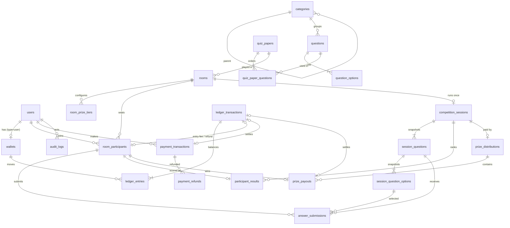

# Database Schema (Phase 01)

MariaDB 10.4+ / MySQL 8+. All times are stored in UTC as `DATETIME`. Engine-critical
times use millisecond precision `DATETIME(3)`. `DATETIME` avoids the TIMESTAMP 2038 limit
and does no session-timezone conversion. Money is `BIGINT` in minor units (paisa); there
is no float or decimal money anywhere.

Enum columns are native `ENUM`s with values hard-coded in migrations. They mirror
`app/Enums/*`, and `SchemaEnumAlignmentTest` fails if the two drift apart.

## Relationships

## Tables

### Identity
| Table | Key columns | Constraints and indexes |
|---|---|---|
| `users` (altered) | `display_name` (public alias), `role` ENUM(player, content_manager, competition_manager, finance_manager, admin, super_admin), `status` ENUM(active, restricted, suspended, closed), `status_reason`, `pending_email`, `terms_accepted_at`, `deleted_at` | idx `role`, idx `status`; soft deletes |

Roles are a column; permissions are defined in code (see [ADMIN.md](ADMIN.md)).
`role` and `status` are not mass-assignable.

### Question bank
| Table | Key columns | Constraints and indexes |
|---|---|---|
| `categories` | `parent_id` (self), `slug`, `sort_order` | unique `slug`; idx (`parent_id`,`sort_order`); soft deletes |
| `questions` | `category_id`, `difficulty`, `status`, `default_time_limit_seconds` NULL | idx (`category_id`,`status`); CHECK limit 5–600 s; soft deletes |
| `question_options` | `question_id`, `position`, `is_correct`, generated `correct_marker` | unique (`question_id`,`position`); **unique (`question_id`,`correct_marker`) = at most one correct option**; CHECK position ≥ 1 |
| `quiz_papers` | `status`, `default_time_limit_seconds` (20) | idx `status`; CHECK 5–600 s; soft deletes |
| `quiz_paper_questions` | `position`, `time_limit_seconds` NULL, `points` | unique (`quiz_paper_id`,`position`); unique (`quiz_paper_id`,`question_id`); CHECKs |

**Phase 05 additions:** `tags` + `question_tag` (pivot, cascade); `questions.image_path` / `image_alt` (private disk, re-encoded WebP), `body_hash` (sha256 of normalized text, indexed, for duplicate detection), `updated_by`; `quiz_papers.target_question_count` (CHECK 1–200), `published_at`, `updated_by`; `session_questions.image_path`.

**Snapshot immutability (Phase 05):** trigger `session_questions_content_immutable` rejects any UPDATE that changes snapshot content (session, source, position, body, explanation, image, time limit, points); only `opens_at` / `closes_at` / `revealed_at` may change. `session_questions` rejects DELETE; `session_question_options` (incl. the answer key) is fully append-only.

Time limit resolution: paper item, then question default, then paper default
(`QuizPaperQuestion::effectiveTimeLimitSeconds()`). The resolved value is frozen into
`session_questions.time_limit_seconds`.

### Rooms and participation
| Table | Key columns | Constraints and indexes |
|---|---|---|
| `rooms` | `type` ENUM(scheduled, fill), `status` ENUM(draft, scheduled, open, full, in_progress, completed, cancelled, refunded), `entry_fee_minor` UNSIGNED, `min/max_participants`, `participants_count`, registration window, `scheduled_start_at`, `countdown_seconds`, `question_gap_seconds`, `lock_version` | idx (`status`,`scheduled_start_at`), (`type`,`status`); **CHECK `participants_count <= max_participants`** and `max >= min >= 1`; CHECK window order |
| `room_prize_tiers` | `rank_from`, `rank_to`, `amount_minor` | unique (`room_id`,`rank_from`); CHECK `rank_to >= rank_from >= 1` |
| `room_participants` | `status` ENUM(joined, withdrawn, playing, finished, disqualified, refunded), `entry_fee_minor` (frozen), `entry_/refund_ledger_transaction_id`, `joined_at`… | **unique (`room_id`,`user_id`)**; each ledger FK unique; idx (`room_id`,`status`), (`user_id`,`status`) |

### Competition engine
| Table | Key columns | Constraints and indexes |
|---|---|---|
| `competition_sessions` | `status` ENUM(pending, countdown, in_progress, scoring, completed, aborted), `current_question_position`, lifecycle times (ms), `lock_version` | **unique `room_id`** (a room runs once); idx `status` |
| `session_questions` | snapshot `body`, `explanation`, `time_limit_seconds`, `points`, `opens_at`/`closes_at`/`revealed_at`/`delivered_at`/`closed_at` (ms), `voided_at`/`void_reason` (result corrections) | unique (`session`,`position`); CHECK 5–600 s; CHECK `closes_at > opens_at` |
| `session_question_options` | snapshot `body`, `position`, `is_correct`, `correct_marker` | unique position; at most one correct; unique (`session_question_id`,`id`) as FK target |
| `answer_submissions` | `received_at` (server, ms), `response_time_ms`, `is_correct`, `points_awarded` | **unique (`session_question_id`,`room_participant_id`)**; **composite FK: the option must belong to the same question** |
| `participant_results` | `score`, `correct_count`, `answered_count`, `correct_response_time_ms`, `last_correct_elapsed_ms`, `rank`, `is_winner`, `prize_eligible`, `prize_amount_minor`, `excluded_reason`, `result_version` | unique `room_participant_id`; idx (`session`,`rank`). Rank isn't unique, so ties can share it. Rewritten on each result version |
| `result_versions` | `version`, `scoring_policy`, `tie_break_policy`, `reason`, `inputs_hash`, `inputs`/`results`/`prizes` json, `created_by` | unique (`session`,`version`). **Append-only** (triggers block update and delete) |
| `result_disputes` | `room_participant_id`, `raised_by`, `message`, `status` (open/rejected/resolved), `resolution`, `resolved_by/at`, `result_version_before/after` | idx (`session`,`status`) |

### Money
| Table | Key columns | Constraints and indexes |
|---|---|---|
| `wallets` | `type` ENUM(user, system), `user_id`/`system_code`, `currency`, `balance_minor` (signed cache), `status` | unique (`user_id`,`currency`); unique (`system_code`,`currency`); CHECK owner matches type; **CHECK user balance ≥ 0** |
| `ledger_transactions` | `reference` (public ULID, unique), `idempotency_key`, `type` ENUM(deposit, withdrawal, entry_fee, entry_refund, prize_payout, adjustment, reversal, platform_fee), morph `reference`, `reverses_transaction_id`, `created_at` (ms) | **unique `idempotency_key`**; unique `reverses_transaction_id` (reversed at most once); **append-only triggers** |
| `ledger_entries` | `amount_minor` (signed), `balance_after_minor` | unique (`transaction`,`wallet`); idx (`wallet_id`,`id`); CHECK ≠ 0; **append-only triggers** |
| `payment_transactions` | `reference` (public ULID, unique), `type` ENUM(deposit, withdrawal), `status` ENUM(created, pending, processing, succeeded, failed, cancelled, expired, refunded), `provider_status`, `checkout` (hidden), `expires_at`, `verified_at`, `gateway`, `amount_minor`, `gateway_payload` (hidden) | **unique `idempotency_key`**; unique (`gateway`,`gateway_reference`); unique `ledger_transaction_id` (settles once); CHECK amount > 0 |
| `payment_callbacks` | `gateway`, `payment_transaction_id`, `body_hash`, `signature_valid`, `outcome` ENUM(applied, duplicate, pending, rejected), `reason`, sanitized `payload`, `ip_address` | idx (`gateway`,`created_at`), `body_hash`; **append-only triggers** |
| `payment_refunds` | `status` ENUM(pending, processing, succeeded, failed), `amount_minor`, `reason` | unique `idempotency_key`; unique `ledger_transaction_id`; CHECK amount > 0 |

### Prizes
| Table | Key columns | Constraints and indexes |
|---|---|---|
| `prize_distributions` | `status` ENUM(calculated, approved, paid, cancelled), `total_amount_minor`, `calculation` JSON (rule inputs and outputs), approval | **unique `competition_session_id`** |
| `prize_payouts` | `rank`, `result_version`, `score`, `correct_count`, `timing_ms`, `rule` json, `amount_minor` (calculated), `tax_withheld_minor`, `net_amount_minor` (credited), `status` ENUM(pending, approved, processing, paid, held, failed, reversed, cancelled), approval/hold/processing/paid/failed/reversal timestamps, `reversal_ledger_transaction_id` | **unique `room_participant_id`**; unique `idempotency_key`; unique `ledger_transaction_id` and `reversal_ledger_transaction_id`; CHECK amount > 0; **triggers: paid rows can only become reversed, reversed rows never change, no deletes** |

`held` (with `status_reason`) records entitlements that cannot be paid yet, for example while payouts are disabled or a dispute is open. Rooms also carry `prize_mode`, `prize_pool_basis`, `prize_pool_minor`, `platform_fee_bp` and `prize_review_required`; tiers carry `percent_bp`; `prize_distributions` carries the pool figures (gross and net entry fees, refunds, platform amount, pool, unallocated). See PRIZES.md.

### Operations
| Table | Notes |
|---|---|
| `notifications` | Laravel standard (UUID, morph notifiable, `read_at`) |
| `audit_logs` | `actor_id` (NULL = system), dotted `action`, morph `auditable`, old/new values, IP, user agent, `created_at` (ms). **Append-only triggers.** |

## Deletion and retention rules

| Data | Rule | Enforcement |
|---|---|---|
| Ledger transactions and entries, audit logs | Never updated or deleted. Corrections are new `reversal`/`adjustment` transactions. | DB triggers (SIGNAL 45000) + `Immutable` model concern |
| Wallets, payments, refunds, prize distributions and payouts | Never deleted. State changes only through their status columns. | `RESTRICT` FKs from the ledger; no delete paths in code |
| Users | Soft delete only (account closure). Hard delete is blocked once a wallet, seat, payment or audit row exists. For personal-data erasure, anonymize name, email and display name instead. | `SoftDeletes` + `RESTRICT` FKs |
| Rooms | Only an empty draft room can be hard-deleted (its prize tiers cascade). Others are cancelled, never deleted. | `RESTRICT` FKs from participants and sessions |
| Sessions, session questions, answers, results | Kept permanently as the auditable record of scoring. | `RESTRICT` FKs |
| Questions, categories, quiz papers | Soft delete. A question used in a paper can't be hard-deleted. Past competitions keep their own snapshot. | `SoftDeletes` + `RESTRICT`; `session_questions.source_question_id` is `SET NULL` |
| Notifications | May be pruned (e.g. read and older than 180 days), to be scheduled in a later phase. | none yet |

Legal retention periods for financial records in Pakistan should be confirmed. Until then,
nothing financial is ever deleted.

## Seeding

| Seeder | Runs in | Creates |
|---|---|---|
| `SystemWalletSeeder` | every environment (idempotent) | zero-balance `prize_pool`, `platform_revenue`, `gateway_clearing`, `adjustments` wallets |
| `DevelopmentSeeder` | `local` / `testing` only; throws in production | `admin@mcq.test` (super admin), `moderator@mcq.test`, `player1..10@mcq.test` (password `password`, **local only**), zero-balance wallets, 3 categories, 8 questions, 1 published paper, 4 **free** rooms (draft, scheduled, open fill room with 3 seats, cancelled). **No ledger, payment, prize-tier amount or payout rows.** |
